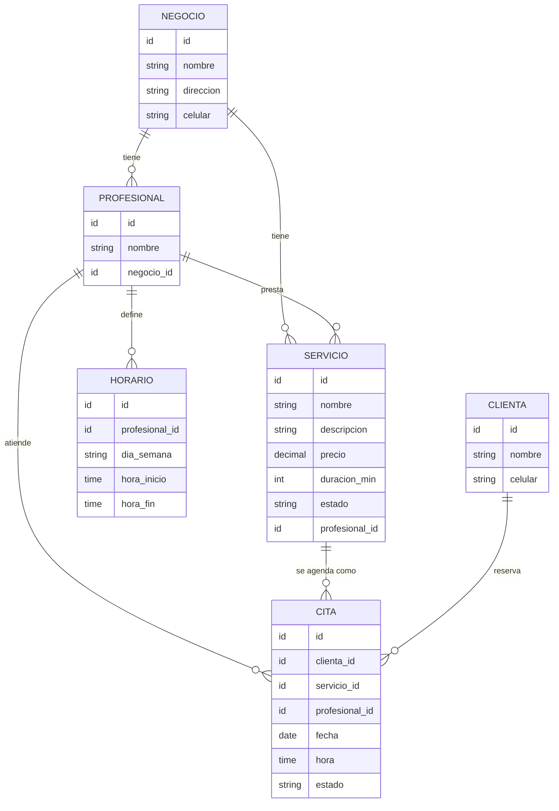

> **Nota de procedencia:** este documento se preservó del repositorio `beauty-salon`, que se
> limpió el 2026-09-17 para convertirlo en el repo de código del frontend. Es el entregable
> **HU-02 — Discovery del Proyecto**, con el sign-off del equipo ya dado. Las referencias a
> `ADR-004` y `ADR-007` al final apuntan a las ADRs originales de `beauty-salon` (stack React
> Native + Expo + Supabase), que ya no rigen: la decisión vigente de stack está en
> [ADR-005](./01-architecture/decisions/records/ADR-005-mobile-stack-ionic-capacitor.md) de este
> repo (Ionic + Capacitor, Android). El resto del contenido (problema, usuarios, alcance del MVP,
> flujos, wireframes) sigue siendo válido tal cual.

# Discovery — Beauty Salon (Corte 1)

**Equipo:** Lilly Puentes, Lizeht Lorena Caicedo Mora
**Entregable de:** HU-02 — Discovery del Proyecto

---

## 1. Problema

En Neiva, agendar una cita de manicure se hace por WhatsApp o por mensaje directo de
Instagram, y eso genera problemas en los dos lados:

**Del lado de la clienta.** Tiene que escribir para preguntar precios, volver a escribir
para preguntar qué días hay libres y esperar la respuesta, que muchas veces llega horas
después. No hay un lugar donde comparar quién presta el servicio, cuánto cobra y cuánto se
demora. Cuando por fin acuerdan una hora, la cita queda solo en un chat: no hay confirmación
formal ni recordatorio.

**Del lado del negocio.** La manicurista lleva la agenda en un cuaderno o en las notas del
celular, así que se le cruzan dos clientas a la misma hora, se le olvidan citas y pierde el
cupo cuando alguien no llega y no avisó. Además pasa el día contestando los mismos tres
mensajes: "¿cuánto vale?", "¿qué días tienes?", "¿a qué horas?".

---

## 2. Usuarios objetivo

| | Clienta | Negocio / emprendedora |
|---|---|---|
| **Quién es** | Mujeres de Neiva entre 18 y 45 años que se hacen las uñas una o dos veces al mes | Manicuristas independientes que trabajan desde su casa y pequeños salones de la ciudad, con una o varias profesionales |
| **Hoy resuelve el problema con** | WhatsApp / Instagram DM | Cuaderno o notas del celular |
| **Qué necesita** | Ver qué hay, cuánto vale y qué horas están libres, y reservar sin escribirle a nadie | Publicar sus servicios y su horario una sola vez, y que las citas le lleguen ya organizadas |
| **Frustración principal** | Esperar horas una respuesta para saber si hay cupo | Que se le crucen dos clientas a la misma hora |

---

## 3. Investigación de soluciones similares en el mercado

| Plataforma | Modelo | Fortaleza | Por qué no resuelve el problema en Neiva |
|---|---|---|---|
| **Booksy** | Suscripción (planes desde ~35 €/mes) + marketplace | App muy pulida, buena adquisición de clientes nuevos | Pensada para salones ya establecidos que pueden pagar una suscripción mensual en dólares/euros; sin presencia real en manicuristas independientes de Neiva |
| **Fresha** | Gratis para el negocio, cobra comisión (~2,6%) por reservas del marketplace | El más grande globalmente, fácil de empezar | El marketplace no tiene tracción de clientas en Neiva — sin clientas ya en la plataforma, publicar ahí no resuelve el "catálogo vacío" |
| **Treatwell** | Cuota anual (~195 €) + comisión por reserva | Marketplace muy conocido en España entre clientas finales | Sin presencia ni marca reconocida en Colombia/Neiva; cuota fija no tiene sentido para una manicurista independiente |
| **StyleSeat** | Suscripción mensual | Popular en EE. UU. para profesionales independientes | Mismo problema: sin presencia local, pensado para pagos en USD y un mercado distinto |
| **WhatsApp / Instagram (lo que se usa hoy)** | Gratis | Ya lo usan todas | Es exactamente lo que falla: sin catálogo, sin horario visible, sin confirmación formal |

**Conclusión del discovery:** las plataformas globales existen y son maduras, pero ninguna
tiene tracción real entre manicuristas independientes de Neiva — son caras para su volumen
de clientas, dependen de un marketplace que ahí no tiene usuarias, y no van a delegar en
Booksy o Fresha algo que hoy ya resuelven "gratis" con WhatsApp. La oportunidad de Beauty
Salon no es competir de frente con esos gigantes, sino ser la opción simple y local que
reemplace el cuaderno y el chat, sin cuota ni comisión que una manicurista de Neiva no esté
dispuesta a pagar.

*(Fuentes consultadas: comparativas de software de reservas para salones y estudios de
manicura, 2026 — Fresha, Reservio, Wilapp, Turnito.)*

---

## 4. Funcionalidades candidatas

Todas las funciones consideradas, antes de decidir cuáles entran al MVP:

| Funcionalidad | Lado | ¿Entra al MVP del Corte 1? |
|---|---|---|
| Publicar servicio (nombre, descripción, precio, duración) | Negocio | ✅ Sí |
| Asignar profesional y horario de atención | Negocio | ✅ Sí |
| Cálculo automático de cupos agendables | Negocio | ✅ Sí |
| Pausar un servicio sin borrarlo | Negocio | ✅ Sí |
| Explorar catálogo y filtrar por tipo de servicio | Clienta | ✅ Sí |
| Ver detalle de un servicio | Clienta | ✅ Sí |
| Agendar cita sobre un cupo real | Clienta | ✅ Sí |
| Ver "Mis citas" y cancelar | Clienta | 🟡 Deseable — Sprint 3 |
| Gestionar la agenda del día (confirmar/rechazar/marcar atendida) | Negocio | 🟡 Deseable — Sprint 3 |
| Pagos dentro de la app | Ambos | ❌ Fuera del MVP |
| Chat entre clienta y negocio | Ambos | ❌ Fuera del MVP |
| Calificaciones y reseñas | Ambos | ❌ Fuera del MVP |
| Mapa con salones cercanos | Clienta | ❌ Fuera del MVP |
| Promociones y programa de fidelidad | Negocio | ❌ Fuera del MVP |

---

## 5. Alcance del MVP — Corte 1

### Qué SÍ entra

El MVP se define por **cerrar un ciclo completo una sola vez**:

```
El negocio publica su servicio y su horario
        ↓
La clienta lo encuentra en el catálogo
        ↓
La clienta agenda sobre un cupo que existe de verdad
        ↓
La cita aparece en "Mis citas" de la clienta y en la agenda del negocio
```

**La prueba del MVP** es concreta: que una manicurista real de Neiva publique su servicio y
que una clienta real agende con ella **sin escribir un solo mensaje de WhatsApp**.

### Qué queda explícitamente fuera de este corte

| Fuera del MVP | Por qué se recorta |
|---|---|
| Pagos dentro de la app | En Neiva este servicio se paga en efectivo o por transferencia en el local |
| Chat entre clienta y negocio | Es justo lo que la app viene a reemplazar |
| Calificaciones y reseñas | Sin volumen de usuarias, las reseñas están vacías o son de la propia familia |
| Mapa con salones cercanos | Requiere permisos de ubicación y datos georreferenciados; con la dirección alcanza |
| Promociones y fidelidad | Es una función de crecimiento, no de funcionamiento |

---

## 6. Modelo de datos inicial



La regla que evita el doble agendamiento: **no pueden existir dos Citas con el mismo
`profesional_id`, `fecha` y `hora` en estado `Pendiente` o `Confirmada`.**

---

## 7. Flujos de usuario principales

### 7.1 Flujo del negocio — publicar el servicio

1. Se registra en la app como negocio (nombre del salón, dirección, celular).
2. Registra a las profesionales que atienden (puede ser ella sola o su equipo).
3. Crea un servicio: nombre y descripción de lo que incluye.
4. Le pone precio y duración (la duración es clave: de ahí salen los cupos).
5. Asigna la profesional que presta ese servicio.
6. Define el horario de atención de esa profesional por día de la semana.
7. La app valida la información, genera los cupos agendables (horario ÷ duración) y publica
   el servicio en el catálogo.
8. Cuando no vaya a atender, pausa el servicio: deja de aparecer en el catálogo, pero las
   citas ya agendadas se respetan.

### 7.2 Flujo de la clienta — agendar la cita

1. Abre la app y explora el catálogo, filtrando por tipo de servicio.
2. Abre el detalle: descripción, precio, duración, profesional y dirección.
3. Elige una fecha.
4. La app muestra solo las horas libres de esa profesional ese día.
5. Selecciona la hora y confirma. Si otra clienta ya tomó ese cupo, la app avisa y refresca
   las horas disponibles.
6. La cita queda registrada en estado `Pendiente` y le llega la notificación al negocio.
7. El negocio confirma (o rechaza indicando el motivo) y la clienta recibe el aviso.
8. La cita aparece en "Mis citas".

### 7.3 Reglas de negocio

- Los cupos no se crean a mano, se calculan: `horario ÷ duración del servicio = cupos del día`.
- Una profesional no puede tener dos citas a la misma hora (se valida sobre la profesional,
  no sobre el salón).
- El cupo se valida dos veces: al mostrar las horas y otra vez al confirmar.
- Estados de la cita: `Pendiente → Confirmada → Atendida`, con salidas `Cancelada` y
  `No asistió`.
- Cancelar libera el cupo, hasta 2 horas antes de la cita.
- Pausar un servicio no borra las citas ya agendadas.

---

## 8. Wireframes de las pantallas principales

Wireframes de baja fidelidad (estructura y contenido, sin estilo visual final).

### Catálogo (Clienta)

```
┌─────────────────────────────────┐
│ ☰  Beauty Salon           🔔   │
├─────────────────────────────────┤
│ [ Todos ] [Tradicional] [Semi]  │
│ [Acrílicas] [Retiro] [Decorac.] │
├─────────────────────────────────┤
│ ┌─────────────────────────────┐ │
│ │ 💅 Manicure semipermanente  │ │
│ │ Nails by Kelly · $35.000    │ │
│ │ 45 min                      │ │
│ └─────────────────────────────┘ │
│ ┌─────────────────────────────┐ │
│ │ 💅 Acrílicas decoradas      │ │
│ │ Studio Nails · $60.000      │ │
│ │ 90 min                      │ │
│ └─────────────────────────────┘ │
└─────────────────────────────────┘
```

### Detalle de servicio → Agendar cita (Clienta)

```
┌─────────────────────────────────┐
│ ←  Manicure semipermanente      │
├─────────────────────────────────┤
│ Nails by Kelly                  │
│ $35.000 · 45 min                │
│ Cra 5 # 10-20, Neiva            │
│                                 │
│ Descripción del servicio...     │
│                                 │
│ Elegir fecha:                   │
│ [ Lun 8 ][ Mar 9 ][ Mié 10 ]    │
│                                 │
│ Horas disponibles:              │
│ [ 9:00 ][ 10:30 ][ 14:00 ]      │
│                                 │
│      [  Confirmar cita  ]       │
└─────────────────────────────────┘
```

### Mis citas (Clienta)

```
┌─────────────────────────────────┐
│ ☰  Mis citas                   │
├─────────────────────────────────┤
│ Próximas                        │
│ ┌─────────────────────────────┐ │
│ │ Manicure semipermanente     │ │
│ │ Mar 9 · 10:30 · Pendiente   │ │
│ │           [ Cancelar ]      │ │
│ └─────────────────────────────┘ │
│                                 │
│ Historial                       │
│ ┌─────────────────────────────┐ │
│ │ Acrílicas · Ago 20 · Atendida│ │
│ └─────────────────────────────┘ │
└─────────────────────────────────┘
```

### Publicar servicio (Negocio)

```
┌─────────────────────────────────┐
│ ←  Nuevo servicio               │
├─────────────────────────────────┤
│ Nombre        [______________]  │
│ Descripción   [______________]  │
│ Precio        [______________]  │
│ Duración(min) [______________]  │
│ Profesional   [ Kelly      ▾ ]  │
│ Horario       [ Configurar → ]  │
│                                 │
│         [  Publicar  ]          │
└─────────────────────────────────┘
```

### Agenda del negocio

```
┌─────────────────────────────────┐
│ ☰  Mi agenda — Hoy, Mar 9      │
├─────────────────────────────────┤
│ 9:00   María P. · Semiperm.     │
│        [Confirmar] [Rechazar]   │
│ 10:30  Ana R. · Acrílicas       │
│        Confirmada               │
│ 14:00  — libre —                │
└─────────────────────────────────┘
```

---

## Team sign-off

Alcance del MVP acordado por todo el equipo:

- [x] Lilly Puentes
- [x] Lizeht Lorena Caicedo Mora

---

## Referencias

- Stack vigente: [ADR-005 — Stack de desarrollo móvil (Ionic + Capacitor, Android)](./01-architecture/decisions/records/ADR-005-mobile-stack-ionic-capacitor.md)
- [01-architecture/navigation.md](./01-architecture/navigation.md) — rutas de estas pantallas
- [03-api-and-data/persistence.md](./03-api-and-data/persistence.md) — modelo de datos completo
