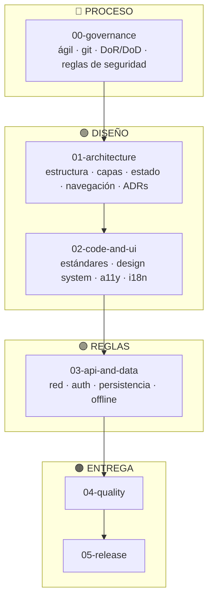

# Beauty Salon — ManiCita

Aplicación móvil de agendamiento de servicios de manicure en Neiva.

---

## Ficha del proyecto (c3-project · fase 0)

Alcance cerrado del proyecto de aula del corte 3. **Esta ficha es el contrato**: lo que aquí se lista
es lo que el código de `beauty-salon-app`, `beauty-salon-api` y `beauty-salon-infra` entrega en la
etiqueta `v1.0.0`, y no se reduce sin avisar por Moodle.

| Campo | Respuesta del equipo |
|-------|----------------------|
| **Nombre del producto y team de GitHub** | ManiCita (Beauty Salon) · team `beauty-salon` de la organización `code-corhuila` |
| **Integrantes** | Lilly Signey Puentes Rincón — [`LillyPuentes-2003`](https://github.com/LillyPuentes-2003) (lead) Lizeth Lorena Caicedo Mora — [`LizethC10`](https://github.com/LizethC10) |
| **Problema que resuelve** | En Neiva agendar una manicure se hace por WhatsApp: la clienta espera respuesta para saber precios y horas libres, y la manicurista lleva la agenda en un cuaderno donde a veces cruza dos clientas a la misma hora. ManiCita deja que el negocio publique sus servicios con horario y que la clienta reserve solo sobre cupos que existen de verdad. |
| **Funcionalidades (lista cerrada)** | 1. Registro como clienta o como negocio — HU-08 2. Inicio de sesión con token — HU-09 3. Sesión persistente al reabrir la app — HU-10 4. Envío del token y renovación transparente — HU-11 5. Cierre de sesión — HU-12 6. Rutas protegidas por rol — HU-13 7. Catálogo de servicios con filtro por tipo y detalle del servicio, visible sin red desde la caché local — HU-14 8. CRUD de profesionales del negocio — HU-15 9. CRUD de servicios del negocio con su horario, y pausar / publicar — HU-16 10. Agendar una cita sobre un cupo libre — HU-17 11. Mis citas (próximas y pasadas), detalle y cancelación — HU-18 12. Agenda del negocio por día: confirmar o rechazar citas — HU-19 |
| **Pantallas de la aplicación** | Públicas: [Login](./01-architecture/screens/login.md) `/login`, [Registro](./01-architecture/screens/registro.md) `/register`, [Catálogo](./01-architecture/screens/catalogo.md) `/services`, [Detalle del servicio](./01-architecture/screens/detalle-servicio.md) `/service/:serviceId` Clienta: [Agendar cita](./01-architecture/screens/agendar-cita.md) `/book/:serviceId`, [Mis citas](./01-architecture/screens/mis-citas.md) `/my-appointments`, [Detalle de la cita](./01-architecture/screens/detalle-cita.md) `/appointment/:appointmentId` Clienta y negocio: [Mi cuenta](./01-architecture/screens/cuenta.md) `/account` (cerrar sesión) Negocio: [Mis servicios](./01-architecture/screens/negocio-servicios.md) `/business/services`, [Formulario de servicio](./01-architecture/screens/negocio-servicio-form.md) `/business/service/new` (crear, editar y eliminar), [Mis profesionales](./01-architecture/screens/negocio-profesionales.md) `/business/professionals`, [Agenda del negocio](./01-architecture/screens/negocio-agenda.md) `/business/agenda` |
| **Entidades y relaciones** | `user_account` (cuenta con rol) **1–1** `business` · `business` **1–N** `professional` · `business` **1–N** `service` · `professional` **1–N** `service` · `service` **1–N** `schedule` (horario por día de la semana) · `user_account` (clienta) **1–N** `appointment` · `service` **1–N** `appointment` · `professional` **1–N** `appointment` · `user_account` **1–N** `revoked_refresh_token`. CRUD completo: **`professional`** y **`service`** (relacionados entre sí). Detalle en [`data-model.md`](./03-api-and-data/data-model.md) |
| **Roles y qué puede hacer cada uno** | **Visitante (sin sesión):** ver el catálogo y el detalle de un servicio. **`client` (clienta):** todo lo anterior, agendar una cita, ver sus citas y cancelarlas. **`business` (negocio):** CRUD de sus profesionales y de sus servicios con horario, pausar / publicar servicios, ver su agenda del día y confirmar o rechazar citas. Ningún rol ve ni modifica datos de otra cuenta |
| **Regla de negocio propia** | **No se puede reservar un cupo que no existe o que ya está ocupado.** Los cupos no se crean a mano: se calculan como *horario de atención del servicio ÷ duración del servicio*, y solo a futuro. Una profesional no puede tener dos citas activas a la misma hora: la base de datos lo impide con un índice único parcial y la API responde **409 `SLOT_TAKEN`** aunque dos clientas confirmen en el mismo instante. Además, una cita solo se cancela o se responde si sigue en un estado que lo permite (409 si no) |
| **Endpoints (método y ruta)** | Base `/v1`. Detalle en [`api-contract.md`](./03-api-and-data/api-contract.md) `POST /auth/register` · `POST /auth/login` · `POST /auth/refresh` · `POST /auth/logout` `GET /services` · `GET /services/{serviceId}` · `GET /services/{serviceId}/availability` `POST /appointments` · `GET /appointments/mine` · `PATCH /appointments/{appointmentId}/cancel` `GET /business/professionals` · `POST /business/professionals` · `PUT /business/professionals/{professionalId}` *(nuevo)* · `DELETE /business/professionals/{professionalId}` *(nuevo)* `GET /business/services` · `POST /business/services` · `PUT /business/services/{serviceId}` · `DELETE /business/services/{serviceId}` *(nuevo)* · `PATCH /business/services/{serviceId}/status` `GET /business/agenda` · `PATCH /business/appointments/{appointmentId}/respond` Total: 21 (18 ya implementados + 3 nuevos para completar los CRUD) |
| **Plugin nativo o almacenamiento local** | **SQLite** con `@capacitor-community/sqlite` y Drizzle ORM ([ADR-007](./01-architecture/decisions/records/ADR-007-local-storage-capacitor.md)): la app guarda en el teléfono una copia del catálogo y del detalle de los servicios, de modo que la clienta los sigue viendo sin red. Es solo caché: la fuente de verdad es la API. En el navegador funciona con el respaldo web `jeep-sqlite`. Los tokens de sesión se guardan en almacenamiento seguro (`capacitor-secure-storage-plugin`) |
| **Tecnología** | **App:** Ionic React 9 + React 19 + TypeScript 5.9 sobre Capacitor 8, Vite, Zustand, axios ([ADR-005](./01-architecture/decisions/records/ADR-005-mobile-stack-ionic-capacitor.md)) **API:** Node.js + Express 4, JWT (access + refresh con rotación), bcrypt ([ADR-009](./01-architecture/decisions/records/ADR-009-backend-repo-and-stack.md)) **Base de datos:** PostgreSQL 16 con migraciones versionadas en la API **Infra:** Docker Compose ([ADR-011](./01-architecture/decisions/records/ADR-011-cuatro-repositorios.md)) |
| **Repositorios** | [`beauty-salon-docs`](https://github.com/code-corhuila/beauty-salon-docs) · [`beauty-salon-app`](https://github.com/code-corhuila/beauty-salon-app) · [`beauty-salon-api`](https://github.com/code-corhuila/beauty-salon-api) · [`beauty-salon-infra`](https://github.com/code-corhuila/beauty-salon-infra) |
| **Responsable de cada repositorio** | Responsabilidad compartida: Lilly Signey Puentes Rincón y Lizeth Lorena Caicedo Mora responden por los cuatro repositorios |

---

> ### 📌 Política de ramas de este repositorio
>
> **Este repositorio de documentación es el ÚNICO del proyecto que NO usa ramas: se trabaja siempre y solo sobre `main`.**
>
> Se hace así a propósito, para **evitar incongruencias en la documentación** mientras el equipo sube cambios en paralelo. Toda edición de estos documentos se realiza y se commitea directamente a `main`.
>
> ⚠️ **Los demás repositorios del proyecto (el código de la app) SÍ deben seguir la estrategia de ramas** definida en [`00-governance/git-conventions.md`](./00-governance/git-conventions.md): ramas de feature, pull requests y revisión antes de hacer merge.

---

## Qué es este repositorio

Es la **documentación de diseño** de ManiCita, escrita antes del código siguiendo el enfoque
SDD descrito en [`00-sdd-guide.md`](./00-sdd-guide.md): primero se decide y se escribe, después
se implementa.

Este es el único repo de documentación del proyecto. `beauty-salon` (el repo original) se limpió
el 2026-09-17 y es el **repo de código de la API** ([ADR-009](./01-architecture/decisions/records/ADR-009-backend-repo-and-stack.md)).
El código del frontend vive en un repo aparte, aún sin crear. El [`DISCOVERY.md`](./DISCOVERY.md)
de esta sección (entregable HU-02) se preservó y se trasladó aquí desde `beauty-salon`.

**Estudiantes:** Lilly Signey Puentes Rincon y Lizeth Caicedo
**Asignatura:** Programación Móvil [G1] — 2026-B · CORHUILA

---

## El producto en una frase

En Neiva agendar una manicure todavía se hace por WhatsApp: la clienta pregunta precios, pregunta
qué días hay libres y espera horas, mientras la manicurista lleva la agenda en un cuaderno y a veces
cruza dos clientas a la misma hora. **ManiCita es un producto de dos lados**: el negocio publica sus
servicios con precio, duración, profesional y horario, y la clienta agenda sobre un cupo que existe
de verdad.

La decisión de diseño que sostiene todo el proyecto: **el lado del negocio es parte del MVP**, porque
sin servicios publicados el catálogo de la clienta abre vacío y no hay nada que agendar. Y **los cupos
no se crean a mano, se calculan**: `horario de atención ÷ duración del servicio`.

---

## Decisiones que rigen toda la documentación

Se tomaron antes de escribir las secciones 01, 02 y 03, y cada una tiene su ADR en
[`01-architecture/decisions/`](./01-architecture/decisions/).

| # | Decisión | Elegido | ADR |
|---|----------|---------|-----|
| 1 | Patrón de estado | Store unidireccional con estado inmutable (Zustand) | [ADR-006](./01-architecture/decisions/records/ADR-006-state-management-pattern.md) |
| 2 | Stack móvil | Ionic React + TypeScript sobre Capacitor, **solo Android** en la primera entrega | [ADR-005](./01-architecture/decisions/records/ADR-005-mobile-stack-ionic-capacitor.md) |
| 3 | Almacenamiento local | SQLite (`@capacitor-community/sqlite`) con Drizzle ORM | [ADR-007](./01-architecture/decisions/records/ADR-007-local-storage-capacitor.md) |
| 4 | Inyección de dependencias | Composition root manual + React Context | [ADR-008](./01-architecture/decisions/records/ADR-008-dependency-injection.md) |
| 5 | Idioma | Documentación en español. **Todo identificador en inglés**: tablas y columnas (singular, `snake_case`), rutas de la API y de la app, valores de enumeración (`pending`, `client`, `semi_permanent`), campos del JSON (`camelCase`) y nombres de archivo de endpoints y entidades. Los textos que lee la persona (i18n, mensajes de error) van en español | [ADR-012](./01-architecture/decisions/records/ADR-012-nombres-en-ingles.md) |
| 6 | Backend | Node.js + Express + PostgreSQL, **implementado** en `beauty-salon-api` siguiendo tal cual el contrato ya diseñado en `03-api-and-data/endpoints/`. Cuatro repos: `beauty-salon-docs`, `beauty-salon-infra`, `beauty-salon-api` y `beauty-salon-app` | [ADR-009](./01-architecture/decisions/records/ADR-009-backend-repo-and-stack.md), [ADR-011](./01-architecture/decisions/records/ADR-011-cuatro-repositorios.md) |
| 7 | Pruebas | Vitest + React Testing Library y Cypress en la app; `node:test` y el smoke test contra PostgreSQL real en la API | [ADR-013](./01-architecture/decisions/records/ADR-013-herramientas-de-prueba.md) |
| 8 | Distribución | APK firmado adjunto a un GitHub Release, construido por GitHub Actions; sin Google Play durante el semestre | [ADR-014](./01-architecture/decisions/records/ADR-014-distribucion-github-releases.md) |
| 9 | Cliente HTTP | Una sola instancia de axios en `core/network/`, con reintento solo de lecturas y errores `problem+json` traducidos a errores de dominio | [ADR-015](./01-architecture/decisions/records/ADR-015-cliente-http-axios.md) |
| 10 | Ramas | En app, api e infra todo entra a `main` por PR desde `feat/` o `fix/`, con merge commit para conservar la autoría; `v1.0.0` en `main`. El docs sigue en una sola rama | [ADR-016](./01-architecture/decisions/records/ADR-016-ramas-feat-fix-con-pr.md) |
| 11 | Borrado | Profesional y servicio se eliminan de verdad solo si no tienen historia; con citas, 409 y el servicio se pausa | [ADR-017](./01-architecture/decisions/records/ADR-017-borrado-fisico-restringido.md) |

> **Decisión 2 revisada el 2026-09-17:** el stack original ([ADR-002](./01-architecture/decisions/records/ADR-002-mobile-stack.md),
> React Native + Expo) fue desempatado por la posibilidad de compilar iOS en la nube sin Mac. Al
> definirse que la primera entrega de ManiCita sale **solo para Android**, esa restricción dejó de
> aplicar y el stack se revisó a Ionic + Capacitor en [ADR-005](./01-architecture/decisions/records/ADR-005-mobile-stack-ionic-capacitor.md).
> Las decisiones 1 y 4 no cambiaron de fondo, pero se reafirmaron en ADR-006 y ADR-008 porque, según la
> convención propia de este repo, cambiar el stack obliga a revisar todo lo que dependía de él.

> **Decisión 6 revisada el 2026-09-18:** el profesor indicó que `beauty-salon` (el repo limpiado el
> 2026-09-17 para ser el frontend) debe usarse como **repo de la API**, no de frontend. Se decidió el
> stack (Node.js + Express + PostgreSQL) en [ADR-009](./01-architecture/decisions/records/ADR-009-backend-repo-and-stack.md).
> El frontend Ionic + Capacitor ([ADR-005](./01-architecture/decisions/records/ADR-005-mobile-stack-ionic-capacitor.md))
> se mueve a un repo nuevo, todavía sin crear.

> **Decisión 6 revisada de nuevo el 2026-09-18:** para no bloquear el avance del frontend mientras
> ese repo nuevo no se crea, el equipo decidió trabajar la v1 como **monorepo**: `beauty-salon`
> contiene carpetas `backend/` y `frontend/` separadas, con migración planeada a repos separados en
> una próxima iteración. Ver [ADR-010](./01-architecture/decisions/records/ADR-010-monorepo-temporal.md).

> **Decisión 6 revisada el 2026-09-25:** con el Manual de contrato de datos y API del curso, el
> monorepo se separó en cuatro repositorios hermanos: `beauty-salon-docs`, `beauty-salon-infra`
> (compose, sin esquema), `beauty-salon-api` (antes `beauty-salon`; la API y el esquema) y
> `beauty-salon-app` (el antiguo `frontend/`). Ver [ADR-011](./01-architecture/decisions/records/ADR-011-cuatro-repositorios.md).

> **2026-10-07:** las secciones `04-quality` y `05-release` quedan adaptadas a ManiCita, con 10 casos
> de prueba, la checklist del primer release y dos ADR nuevas (013 pruebas, 014 distribución).

---

## Orden de lectura

## Secciones

| # | Sección | Contenido |
|---|---------|-----------|
| [00](./00-governance/) | Governance | Proceso ágil, convenciones de git, DoR/DoD, reglas de seguridad |
| [01](./01-architecture/) | Architecture | Estructura, capas, estado, navegación, ADRs, features y pantallas |
| [02](./02-code-and-ui/) | Code & UI | Estándares de código, design system, accesibilidad, i18n, componentes |
| [03](./03-api-and-data/) | API & Data | Red, autenticación, persistencia, offline, endpoints y entidades |
| [04](./04-quality/) | Quality | Estrategia de pruebas, presupuestos de rendimiento, checklist de seguridad, casos de prueba |
| [05](./05-release/) | Release | CI/CD, firma y distribución, observabilidad, checklist por release |

---

## Framework base

Este repositorio parte del **Mobile Governance Framework v1.0.0** de
[Jesus Ariel Gonzalez Bonilla](https://github.com/jesusarielgb-works), licencia MIT.

> Gonzalez Bonilla, J. A. (2026). *Mobile Governance Framework* (v1.0.0). jesusarielgb-works. https://github.com/jesusarielgb-works/mobile-governance-framework

## Licencia

MIT — ver [LICENSE](LICENSE).
