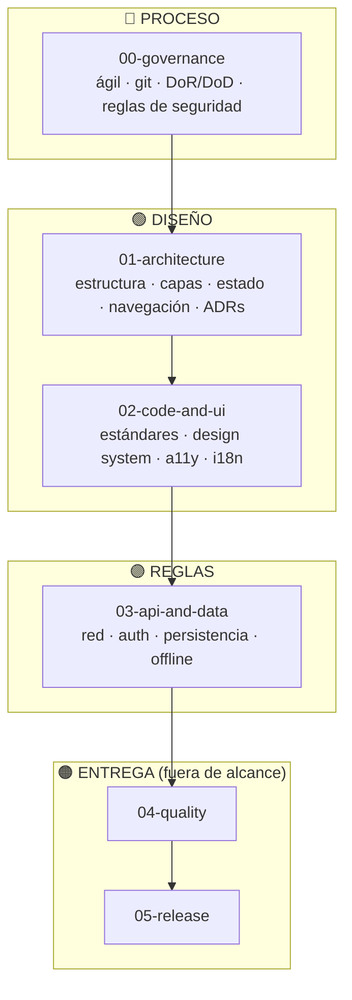

# Beauty Salon — ManiCita

Aplicación móvil de agendamiento de servicios de manicure en Neiva.

---

> ### 📌 Política de ramas de este repositorio
>
> **Este repositorio de documentación es el ÚNICO del proyecto que NO usa ramas: se trabaja siempre y solo sobre `main`.**
>
> Se hace así a propósito, para **evitar incongruencias en la documentación** mientras el equipo sube cambios en paralelo. Toda edición de estos documentos se realiza y se commitea directamente a `main`.
>
> ⚠️ **Los demás repositorios del proyecto (el código de la app) SÍ deben seguir la estrategia de ramas** definida en [`00-governance/git-conventions.md`](./00-governance/git-conventions.md): ramas de feature, pull requests y revisión antes de hacer merge.

---

## Qué es este repositorio

Es la **documentación de diseño** de ManiCita, escrita antes del código siguiendo el enfoque
SDD descrito en [`00-sdd-guide.md`](./00-sdd-guide.md): primero se decide y se escribe, después
se implementa.

Este es el único repo de documentación del proyecto. `beauty-salon` (el repo original) se limpió
el 2026-09-17 y es el **repo de código de la API** ([ADR-009](./01-architecture/decisions/records/ADR-009-backend-repo-and-stack.md)).
El código del frontend vive en un repo aparte, aún sin crear. El [`DISCOVERY.md`](./DISCOVERY.md)
de esta sección (entregable HU-02) se preservó y se trasladó aquí desde `beauty-salon`.

**Estudiantes:** Lilly Signey Puentes Rincon y Lizeth Caicedo
**Asignatura:** Programación Móvil [G1] — 2026-B · CORHUILA

---

## El producto en una frase

En Neiva agendar una manicure todavía se hace por WhatsApp: la clienta pregunta precios, pregunta
qué días hay libres y espera horas, mientras la manicurista lleva la agenda en un cuaderno y a veces
cruza dos clientas a la misma hora. **ManiCita es un producto de dos lados**: el negocio publica sus
servicios con precio, duración, profesional y horario, y la clienta agenda sobre un cupo que existe
de verdad.

La decisión de diseño que sostiene todo el proyecto: **el lado del negocio es parte del MVP**, porque
sin servicios publicados el catálogo de la clienta abre vacío y no hay nada que agendar. Y **los cupos
no se crean a mano, se calculan**: `horario de atención ÷ duración del servicio`.

---

## Decisiones que rigen toda la documentación

Se tomaron antes de escribir las secciones 01, 02 y 03, y cada una tiene su ADR en
[`01-architecture/decisions/`](./01-architecture/decisions/).

| # | Decisión | Elegido | ADR |
|---|----------|---------|-----|
| 1 | Patrón de estado | Store unidireccional con estado inmutable (Zustand) | [ADR-006](./01-architecture/decisions/records/ADR-006-state-management-pattern.md) |
| 2 | Stack móvil | Ionic React + TypeScript sobre Capacitor, **solo Android** en la primera entrega | [ADR-005](./01-architecture/decisions/records/ADR-005-mobile-stack-ionic-capacitor.md) |
| 3 | Almacenamiento local | SQLite (`@capacitor-community/sqlite`) con Drizzle ORM | [ADR-007](./01-architecture/decisions/records/ADR-007-local-storage-capacitor.md) |
| 4 | Inyección de dependencias | Composition root manual + React Context | [ADR-008](./01-architecture/decisions/records/ADR-008-dependency-injection.md) |
| 5 | Idioma de la documentación | Español en todo lo que se adapta al proyecto; los nombres de archivo, las claves de i18n y los términos técnicos estándar (`loading`, `offline-first`, DTO) se mantienen en inglés | — |
| 6 | Backend | Node.js + Express + PostgreSQL, **implementado** en `beauty-salon/backend/` (monorepo temporal, ver ADR-010) siguiendo tal cual el contrato ya diseñado en `03-api-and-data/endpoints/` | [ADR-009](./01-architecture/decisions/records/ADR-009-backend-repo-and-stack.md), [ADR-010](./01-architecture/decisions/records/ADR-010-monorepo-temporal.md) |

> **Decisión 2 revisada el 2026-09-17:** el stack original ([ADR-002](./01-architecture/decisions/records/ADR-002-mobile-stack.md),
> React Native + Expo) fue desempatado por la posibilidad de compilar iOS en la nube sin Mac. Al
> definirse que la primera entrega de ManiCita sale **solo para Android**, esa restricción dejó de
> aplicar y el stack se revisó a Ionic + Capacitor en [ADR-005](./01-architecture/decisions/records/ADR-005-mobile-stack-ionic-capacitor.md).
> Las decisiones 1 y 4 no cambiaron de fondo, pero se reafirmaron en ADR-006 y ADR-008 porque, según la
> convención propia de este repo, cambiar el stack obliga a revisar todo lo que dependía de él.

> **Decisión 6 revisada el 2026-09-18:** el profesor indicó que `beauty-salon` (el repo limpiado el
> 2026-09-17 para ser el frontend) debe usarse como **repo de la API**, no de frontend. Se decidió el
> stack (Node.js + Express + PostgreSQL) en [ADR-009](./01-architecture/decisions/records/ADR-009-backend-repo-and-stack.md).
> El frontend Ionic + Capacitor ([ADR-005](./01-architecture/decisions/records/ADR-005-mobile-stack-ionic-capacitor.md))
> se mueve a un repo nuevo, todavía sin crear.

> **Decisión 6 revisada de nuevo el 2026-09-18:** para no bloquear el avance del frontend mientras
> ese repo nuevo no se crea, el equipo decidió trabajar la v1 como **monorepo**: `beauty-salon`
> contiene carpetas `backend/` y `frontend/` separadas, con migración planeada a repos separados en
> una próxima iteración. Ver [ADR-010](./01-architecture/decisions/records/ADR-010-monorepo-temporal.md).

> Las secciones `04-quality` y `05-release` se conservan tal como vienen del framework original,
> en inglés: quedan fuera del alcance de esta entrega.

---

## Orden de lectura

## Secciones

| # | Sección | Contenido |
|---|---------|-----------|
| [00](./00-governance/) | Governance | Proceso ágil, convenciones de git, DoR/DoD, reglas de seguridad |
| [01](./01-architecture/) | Architecture | Estructura, capas, estado, navegación, ADRs, features y pantallas |
| [02](./02-code-and-ui/) | Code & UI | Estándares de código, design system, accesibilidad, i18n, componentes |
| [03](./03-api-and-data/) | API & Data | Red, autenticación, persistencia, offline, endpoints y entidades |
| [04](./04-quality/) | Quality | *Sin adaptar — fuera del alcance de esta entrega* |
| [05](./05-release/) | Release | *Sin adaptar — fuera del alcance de esta entrega* |

---

## Framework base

Este repositorio parte del **Mobile Governance Framework v1.0.0** de
[Jesus Ariel Gonzalez Bonilla](https://github.com/jesusarielgb-works), licencia MIT.

> Gonzalez Bonilla, J. A. (2026). *Mobile Governance Framework* (v1.0.0). jesusarielgb-works. https://github.com/jesusarielgb-works/mobile-governance-framework

## Licencia

MIT — ver [LICENSE](LICENSE).
